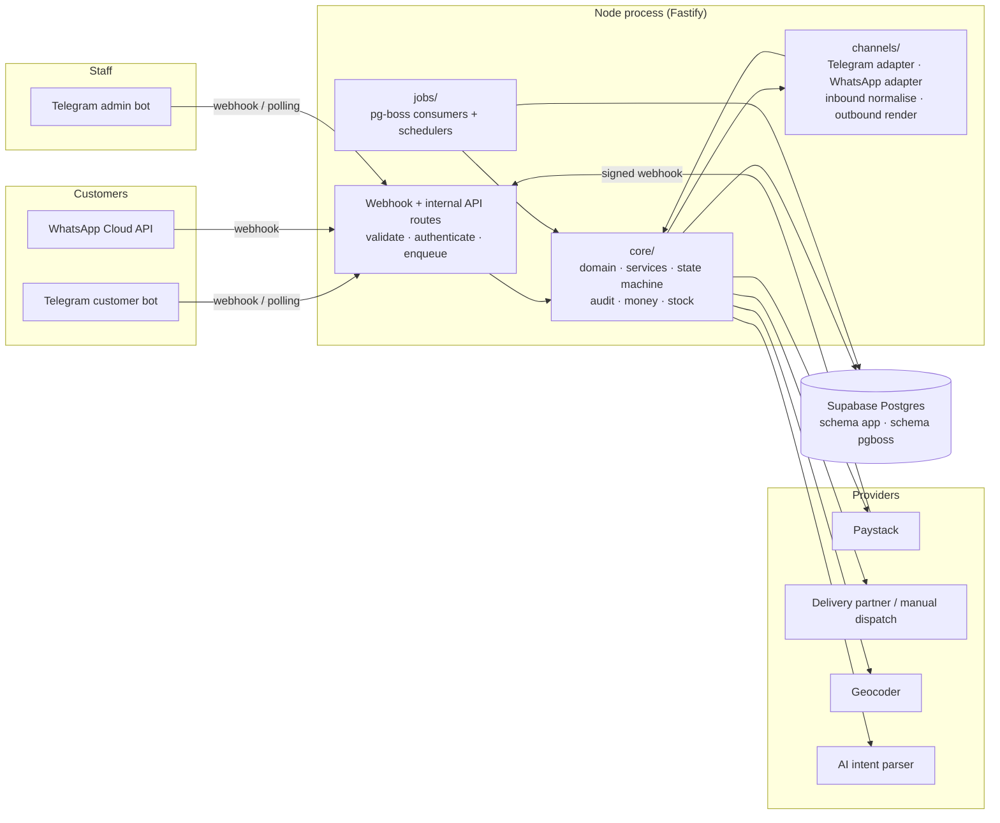

# Architecture

This document explains how the system is put together and, more importantly, **why**. The target
reader is the owner who will maintain it alone. If a section raises a question, the Decision Record
(`DECISION_RECORD.md`) has the alternatives that were rejected.

## 1. Shape: a modular monolith with background workers

One Node.js process (or two, if you choose to split HTTP and workers) talks to one Postgres database.
Everything else — Telegram, WhatsApp, Paystack, the delivery partner, maps, the AI provider — sits
behind an interface and can be swapped or mocked.



**The rule that keeps this maintainable:** `src/core` imports nothing from `fastify`, nothing from
`src/channels`, and nothing from `src/providers/*/client`. It depends only on interfaces it defines
itself. Routes and adapters depend on the core, never the other way round. ESLint enforces this with
import boundaries (phase 3).

## 2. Repository layout

```
src/
  main.ts                 process entry: --http, --worker, or both (default)
  config/env.ts           Zod-validated environment; the only place process.env is read
  core/                   framework-independent business logic (unit-testable, no I/O deps)
    domain/               types + pure functions: Money (kobo), OrderStatus machine, ids
    services/             use-cases: ordering, checkout, payments, inventory, admin, support
    ports/                interfaces the core needs: repositories, PaymentGateway, DeliveryProvider,
                          Geocoder, IntentParser, Clock, Queue, Notifier
    channel/              ChannelAdapter interface + normalised InboundEvent / OutboundMessage
    conversation/         the deterministic customer-flow state machine (channel-neutral)
    audit/                append-only audit log writer with hash chain
  db/
    migrations/           NNNN_description.sql — additive, reviewable
    migrate.ts            runner (advisory lock, transactional, records checksums)
    seed.ts               realistic Nigerian menu and zones
    repositories/         pg implementations of core/ports repositories
  http/
    server.ts             Fastify app factory; plugins: helmet, rate-limit, swagger, auth, errors
    routes/internal/v1/   the versioned internal API (OpenAPI generated)
    routes/webhooks/      telegram, whatsapp, paystack, delivery — verify · dedupe · enqueue · 200
  channels/
    telegram/             Bot API client, rate limiter, inbound normaliser, outbound renderer
    whatsapp/             (phase 9) Cloud API client, window tracking, templates, renderers
  providers/
    paystack/             real client + local mock server
    delivery/             DeliveryProvider: kwik, manual, mock
    geocoder/             none, google, nominatim
    ai/                   IntentParser: deterministic, anthropic
  jobs/                   pg-boss queue setup, consumers, schedules, dead-letter → admin alert
  observability/          logger (pino, PII redaction), metrics, Sentry, admin alerts
test/                     integration + contract tests (real local Postgres when DATABASE_URL_TEST set)
docs/                     this folder
```

## 3. The channel adapter contract

Both Telegram and WhatsApp must produce **identical core behaviour** for the same customer actions.
That is only testable if the core never sees a Telegram `Update` or a WhatsApp webhook payload. So:

- An adapter's inbound side converts a platform event into exactly one `InboundEvent`
  (`src/core/channel/types.ts`): `text`, `button` (a callback with a short opaque id), `location`,
  `contact`, `command`, `media`, `unsupported`, or `delivery_status` (WhatsApp sent/delivered/read).
- The core's conversation engine replies with a list of `OutboundMessage`s built from a small
  vocabulary: `text`, `buttons` (inline choices), `quick_replies` (persistent shortcuts), `list`
  (a paginated menu), `url_button` (the Paystack link), `location_request`, `contact_request`,
  `image`, `edit_previous`.
- The adapter's outbound side renders that vocabulary within the platform's limits (Telegram: inline
  keyboards, 64-byte callback data, message edits; WhatsApp: ≤3 reply buttons, ≤10 list rows,
  templates outside the 24-hour window). **Pagination and limit-splitting are the adapter's job**,
  but the vocabulary is designed so that nothing in the core exceeds the strictest platform (e.g.
  the core never asks for more than 3 primary choices in one `buttons` message; menus use `list`).
- Every `InboundEvent` carries a platform-neutral `identity` (`channel`, `externalUserId`) and an
  idempotency key (`channel` + `platformEventId`). The core dedupes on it.

The contract test in phase 10 feeds the same scripted customer journey through both adapters and
asserts the same orders, payments and audit rows result.

## 4. Request and job flows

### 4.1 Inbound webhook (any platform or provider)

```
POST /webhooks/telegram/customer/<unguessable>
  1. verify  — constant-time compare of the secret header; reject with 401 if wrong
  2. dedupe  — INSERT INTO app.inbound_events (source, external_id) ON CONFLICT DO NOTHING
               → if 0 rows, it is a retry: return 200 immediately
  3. enqueue — pg-boss job "inbound.telegram" with the raw payload, singleton key = external id,
               and a per-user ordering group so one user's messages run in sequence
  4. return 200 within milliseconds
```

Nothing after step 4 is on the request path. If the worker is down, jobs queue in Postgres and drain
when it returns; no update is lost and none is processed twice.

### 4.2 Processing a customer message (worker)

```
inbound.telegram job
  → adapter.normalise(payload) : InboundEvent
  → conversationEngine.handle(event)            # loads conversation state row FOR UPDATE
      → calls core services (cart, checkout, …)  # each in its own DB transaction
      → returns OutboundMessage[] + new state
  → outbound queue (rate-limited per platform/chat) → adapter.render → platform API
```

The conversation state row is locked while a user's event is handled, which (together with the
per-user ordering group) guarantees "messages from one user are processed in order".

### 4.3 Checkout, payment and stock — the money path

This is the path where a bug costs money, so it is spelled out.

1. **Reserve** — `checkout.create(cart)` runs one transaction: it inserts the order as
   `AWAITING_PAYMENT`, and for every line does
   `UPDATE app.inventory SET reserved = reserved + $qty WHERE item_id = $id AND on_hand - reserved >= $qty`.
   If any update touches 0 rows, the whole transaction rolls back and the customer sees "X just sold
   out". Because the check and the increment are one atomic statement, two customers cannot both
   take the last portion — this is the overselling guard and it has a concurrency test.
2. **Initialise payment** — a Paystack transaction is created server-side with a unique reference
   (`LL-<orderId>-<attempt>`), the exact kobo amount, and order metadata. The link goes to the
   customer as a URL button. The order has a `payment_expires_at` (default 15 min).
3. **Confirm** — on a Paystack webhook (signature verified, deduped by event id) _or_ on the
   reconciliation job, the server calls Paystack's **verify** endpoint and marks the order `PAID`
   only if `status=success`, `amount` equals the order total in kobo, `currency=NGN` and the
   reference matches. Amount mismatches become `payment_flags` for an admin, never a silent `PAID`.
   The transition `AWAITING_PAYMENT → PAID` **commits** the reservation (`on_hand -= qty`,
   `reserved -= qty`) and writes an inventory ledger row.
4. **Expire** — a scheduled job moves overdue `AWAITING_PAYMENT` orders to `EXPIRED` and
   **releases** the reservation. If money arrives after expiry, the payment is recorded as
   `late_payment` and an admin is alerted to refund or fulfil — the order is never resurrected
   automatically.
5. **Reconcile** — every 5 minutes, orders in `AWAITING_PAYMENT` older than 2 minutes are verified
   against Paystack; this heals missed or delayed webhooks.

### 4.4 Order lifecycle

Statuses: `PLACED`, `AWAITING_PAYMENT`, `PAID`, `ACCEPTED`, `PREPARING`, `READY`, `DISPATCHED`,
`DELIVERED`, `CANCELLED`, `REJECTED`, `EXPIRED`, `REFUNDED`, `PARTIALLY_REFUNDED`.

| From             | To                 | Who                       | Side effects                                        |
| ---------------- | ------------------ | ------------------------- | --------------------------------------------------- |
| (new)            | PLACED             | customer                  | order + item snapshots created                      |
| PLACED           | AWAITING_PAYMENT   | system (checkout)         | **reserve stock**, init Paystack, notify customer   |
| PLACED           | CANCELLED          | customer                  | —                                                   |
| AWAITING_PAYMENT | PAID               | system (verified payment) | **commit stock**, notify customer + kitchen         |
| AWAITING_PAYMENT | EXPIRED            | system (scheduler)        | **release stock**, notify customer                  |
| AWAITING_PAYMENT | CANCELLED          | customer                  | **release stock**                                   |
| PAID             | ACCEPTED           | kitchen / manager         | notify customer with ETA                            |
| PAID             | REJECTED           | kitchen / manager         | **release stock**, **full refund**, notify customer |
| ACCEPTED         | PREPARING          | kitchen                   | notify customer                                     |
| ACCEPTED         | CANCELLED          | manager / support         | release stock, full refund                          |
| PREPARING        | READY              | kitchen                   | **create delivery task**, notify customer           |
| READY            | DISPATCHED         | dispatch / provider event | notify customer with rider + tracking               |
| DISPATCHED       | DELIVERED          | provider event / dispatch | close delivery task, request feedback               |
| DISPATCHED       | CANCELLED          | manager / support         | refund per policy, cancel delivery                  |
| PAID…DELIVERED   | PARTIALLY_REFUNDED | support (confirmed)       | partial refund via Paystack                         |
| PAID…DELIVERED   | REFUNDED           | support (confirmed)       | full refund via Paystack                            |

Anything not in this table is rejected by the state machine with `InvalidTransitionError`, and the
full matrix (13 × 13) is covered by a generated test.

## 5. Hard problems and how each is solved

| Problem                      | Mechanism                                                                                        | Where                          |
| ---------------------------- | ------------------------------------------------------------------------------------------------ | ------------------------------ |
| Duplicate webhooks           | unique `(source, external_id)` in `inbound_events`; insert-or-ignore before enqueue              | `http/routes/webhooks/*`       |
| Out-of-order events          | handlers are state-machine transitions; a stale event becomes a no-op, logged                    | `core/domain/order-status.ts`  |
| Overselling                  | conditional single-statement `UPDATE … WHERE on_hand - reserved >= qty`                          | `db/repositories/inventory.ts` |
| Double payment               | verify before PAID; second success on a PAID order → `payment_flags` + admin alert + auto-refund | `core/services/payments.ts`    |
| Missed webhooks              | 5-minute reconciliation job calls Paystack verify for pending orders                             | `jobs/reconcile-payments.ts`   |
| Idempotent API               | `Idempotency-Key` header stored with the response hash per actor; replay returns stored result   | `http/plugins/idempotency.ts`  |
| Scheduled jobs running twice | pg-boss cron with singleton + DB-level leader lock                                               | `jobs/schedules.ts`            |
| Tamper-evident audit         | append-only table; trigger forbids UPDATE/DELETE; `prev_hash → hash` SHA-256 chain               | `db/migrations/0002_audit.sql` |
| Rate limits                  | per-IP and per-actor token buckets at HTTP; outbound per-platform/per-chat queue                 | `http/plugins`, `channels/*`   |
| Prompt injection             | AI sees only the user text + closed intent schema; output Zod-validated; buttons on doubt        | `providers/ai/*`               |

## 6. Security boundaries (summary; full checklist in SECURITY.md, phase 8)

- Only the server holds the database password. Supabase anon/service keys are not used by the app.
- Webhook paths are unguessable and signature-verified; the internal API uses signed tokens with a
  per-client role; the admin bot allowlists Telegram user ids and re-confirms sensitive actions.
- Every object access is scoped to the actor (`WHERE customer_id = $actor`), tested for IDOR.
- Logs redact phone numbers, tokens and payment payloads at the logger level, not by convention.

## 7. Local development

`npm run dev` starts HTTP + workers in one process against a local Postgres. Telegram runs in
long-polling mode locally (no public URL). Paystack and the delivery provider are local mock
servers. `npm run dev -- --worker` starts the worker alone; `--http` the server alone — same code,
chosen by flag, which is also how production can split them later.
