# Data model

Schema `app`, PostgreSQL 15+ (Supabase in staging/production, plain Postgres locally). Money is
integer **kobo** in `bigint` columns named `*_kobo`; timestamps are `timestamptz` in UTC. The
migrations in `src/db/migrations/` are the source of truth; this page is the map.

```mermaid
erDiagram
  customers ||--o{ channel_identities : "has"
  customers ||--o{ addresses : "saves"
  customers ||--o{ carts : "owns"
  customers ||--o{ orders : "places"
  customers ||--o{ tickets : "opens"
  customers ||--o{ consents : "gives"
  channel_identities ||--|| conversations : "state"
  channel_identities ||--o{ messages : "log"
  channel_identities ||--o| wa_windows : "24h window"
  delivery_zones ||--o{ addresses : "contains"
  menu_categories ||--o{ menu_items : "groups"
  menu_items ||--o{ menu_variants : ""
  menu_items ||--o{ menu_addons : ""
  menu_items ||--|| inventory : "stock"
  menu_items ||--o{ inventory_movements : "ledger"
  carts ||--o{ cart_items : ""
  orders ||--o{ order_items : "snapshots"
  orders ||--o{ order_status_history : "transitions"
  orders ||--o{ payments : "attempts"
  orders ||--o{ refunds : ""
  orders ||--o{ delivery_tasks : ""
  orders ||--o{ payment_flags : ""
  orders ||--o{ promo_redemptions : ""
  promos ||--o{ promo_redemptions : ""
  payments ||--o{ payment_events : "webhooks"
  payments ||--o{ refunds : ""
  delivery_tasks ||--o{ delivery_events : ""
  staff ||--o{ staff_sessions : ""
  staff ||--o{ staff_confirmations : ""
  tickets ||--o{ ticket_messages : ""
  settings ||--o{ settings_history : ""
```

## Tables by concern

| Concern            | Tables                                                                                                         | Notes                                                                                       |
| ------------------ | -------------------------------------------------------------------------------------------------------------- | ------------------------------------------------------------------------------------------- |
| Identity           | `customers`, `channel_identities`                                                                              | One customer, many chat identities. PII only on `customers` so deletion anonymises one row. |
| Addresses & zones  | `addresses`, `delivery_zones`                                                                                  | Zones are GeoJSON polygons; point-in-polygon runs in app code (no PostGIS).                 |
| Menu               | `menu_categories`, `menu_items`, `menu_variants`, `menu_addons`                                                | `menu_items.aliases` feeds the plain-text order parser; `slug` is the stable import key.    |
| Inventory          | `inventory`, `inventory_movements`                                                                             | `reserved <= on_hand` enforced by CHECK; ledger is append-only.                             |
| Carts & promos     | `carts`, `cart_items`, `promos`, `promo_redemptions`                                                           | One active cart per customer (partial unique index).                                        |
| Orders             | `orders`, `order_items`, `order_status_history`                                                                | Item name/price **snapshots**; `total = subtotal + fee − discount` enforced by CHECK.       |
| Payments           | `payments`, `payment_events`, `payment_flags`, `refunds`                                                       | `payments.reference` is our unique Paystack reference; flags need a human.                  |
| Delivery           | `delivery_tasks`, `delivery_events`                                                                            | Provider-neutral statuses; quote vs charge mismatch → flag.                                 |
| Conversation       | `conversations`, `messages`, `inbound_events`, `idempotency_keys`                                              | `inbound_events` dedupes every webhook; `messages` auto-expire after 90 days.               |
| Staff & admin      | `staff`, `staff_sessions`, `staff_confirmations`, `abuse_strikes`                                              | Allowlist by Telegram id; elevated sessions for sensitive actions.                          |
| Support            | `tickets`, `ticket_messages`                                                                                   |                                                                                             |
| Settings & content | `settings`, `settings_history`, `faq_entries`, `broadcasts`                                                    | JSON values validated per key in code; history append-only.                                 |
| Audit              | `audit_log`                                                                                                    | SHA-256 hash chain computed by trigger; `app.audit_verify()` walks it.                      |
| WhatsApp (phase 9) | `wa_windows`, `wa_delivery_receipts`, `wa_templates`, `consents`, `channel_cost_counts`, `wa_health_snapshots` | Present from day one so phase 9 is additive.                                                |

## Invariants the database enforces (so a code bug cannot break them)

- `inventory.on_hand >= 0`, `reserved >= 0`, `reserved <= on_hand`.
- `orders.total_kobo = subtotal + delivery_fee − discount`; delivery orders carry an address snapshot.
- `payments.reference` unique; `refunds.idempotency_key` unique (a refund request is executed once).
- `(source, external_id)` unique in `inbound_events` and `(provider, external_event_id)` in
  `payment_events` — duplicate webhooks are rejected at insert time.
- `audit_log`, `order_status_history`, `inventory_movements`, `settings_history`: triggers raise on
  UPDATE/DELETE and the runtime role lacks those privileges anyway.
- Every table: RLS enabled and forced; one policy, for `app_runtime` only; `anon`,
  `authenticated` and `service_role` have no grants (tested in `test/db/lockdown.test.ts`).

## Retention

| Data                     | Keep     | Mechanism (phase 7 job)                                     |
| ------------------------ | -------- | ----------------------------------------------------------- |
| `messages`               | ~90 days | `delete_after` column, nightly delete                       |
| `payment_events.payload` | ~90 days | nightly null-out of `payload_redacted`                      |
| `inbound_events`         | 30 days  | nightly delete (dedupe window far exceeds provider retries) |
| `idempotency_keys`       | 7 days   | nightly delete                                              |
| orders, payments, audit  | ~7 years | never deleted; customer deletion anonymises `customers`     |

## Roles and connections

| Role          | Used by                | Can                                                                      | Cannot                                    |
| ------------- | ---------------------- | ------------------------------------------------------------------------ | ----------------------------------------- |
| `app_migrate` | `npm run migrate`      | DDL in `app`, write the migration ledger                                 | read business rows (FORCE RLS, no policy) |
| `app_runtime` | the server and workers | SELECT/INSERT/UPDATE/DELETE per table; INSERT-only on append-only tables | DDL, UPDATE/DELETE on ledgers             |
| `postgres`    | one-time role setup    | everything                                                               | — never configured in the app             |

Adding a table in a future migration: create it, then `SELECT app.lock_down_table('name');`.
